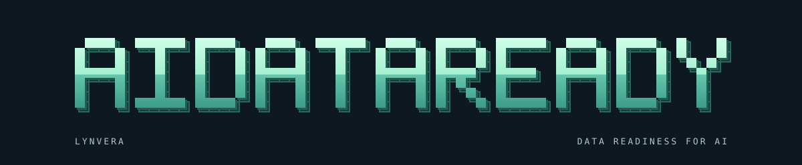

<p align="center">
  
</p>

<h1 align="center">Lynvera AIDataReady</h1>

<p align="center">
  <a href="docs/getting-started.md"></a>
  <a href="docs/releases.md"></a>
  <a href="LICENSE"></a>
  <a href="docs/getting-started.md#installation"></a>
  <a href="docs/es/getting-started.md"></a>
</p>

<p align="center">
  <a href="https://aidataready.lynvera.ai">Official website</a>
  <a href="https://lynvera.ai">Lynvera</a>
  <a href="docs/README.md">Documentation</a>
  <a href="docs/python-api.md">Python API</a>
  <a href="docs/cli.md">CLI reference</a>
  <a href="docs/es/getting-started.md">Español</a>
</p>

**Know your data. Build reliable AI.**

Check whether your data meets the contracts for RAG, machine learning, and agent
tools. Run local assessments from Python or the command line. No models, paid
services, accounts, or telemetry are needed.

**Version 0.1.0, initial MVP.** Python 3.12 or newer. Apache License 2.0.
The package is available from source and has not been published to PyPI.

## What you can check

| Profile | Checks |
| --- | --- |
| `general` | Required fields, logical types, nulls, duplicate IDs, ranges, formats, supplied references, freshness, and schema changes. |
| `rag` | Document IDs, usable text, provenance, versions, exact duplicates, and required filter or permission metadata. |
| `machine-learning` | A configured target, class balance, cardinality, temporal splits, and declared leakage risks. |
| `agent-tools` | IDs, tool fields, documented schemas, contract versions, allowed actions, and authorization metadata. |

Sources include CSV, JSON arrays, JSONL, Parquet, PostgreSQL, and Python records.
Checks use supplied contracts and evidence. They do not certify model quality,
retrieval quality, or effective access permissions.

## Quick start

On macOS or Linux, with Git and Python 3.12 or newer:

```bash
git clone https://github.com/lynvera-ai/aidataready.git
cd aidataready
python3 -m venv .venv
source .venv/bin/activate
python -m pip install .
aidataready check --config examples/rag.yaml
aidataready report --format html
```

The included synthetic documents pass the contract. The first summary line is:

```text
local-knowledge: PASS. Records: 2.
```

Open `aidataready-report.html` locally. It has severity, category, and source
filters and loads no external assets. Reports contain counts and field names,
without record samples.

To see a controlled failure:

```bash
aidataready check --config examples/duplicate-ids.yaml --output duplicates.json
aidataready report --input duplicates.json --output duplicates.html
```

The check reports `FAIL`, with one duplicate ID, and exits 1. That exit code
means a data problem was found. The report can still be generated.

The [getting started guide](docs/getting-started.md) covers Windows, uv, local
packages, and your first contract. The distribution is `lynvera-aidataready`;
the import package is `lynvera_aidataready`.

## Read the result

| Status | `check` exit code | Meaning |
| --- | ---: | --- |
| PASS | 0 | The examined data meets the configured checks. |
| WARN | 0 | A warning needs review, such as class imbalance or possible sensitive data. |
| FAIL | 1 | At least one contract violation was found. |
| ERROR | 2 | Source access or execution prevented assessment. |
| INCONCLUSIVE | 2 | Evidence is missing or the scan cannot establish a result. |

Overall precedence is ERROR, FAIL, INCONCLUSIVE, WARN, PASS. Empty data is
inconclusive. Partial scans cannot produce passing findings. See the
[CLI reference](docs/cli.md) and [contract reference](docs/contracts.md).

## Use it from Python

```python
from lynvera_aidataready import Assessment

result = Assessment.from_config("examples/rag.yaml").run()
print(result.status)
print(result.rows_examined)
```

The [Python API guide](docs/python-api.md) covers in-memory records, report
writers, source extensions, and optional Pandera schemas.

## Connect your data

Create a YAML contract with `aidataready init`. Choose your source, profile,
required fields, and limits. Paths are relative to the contract file.
[Profiles](docs/profiles.md) explain which rules each use case adds.

For PostgreSQL, install the driver from the checkout:

```bash
python -m pip install '.[postgres]'
```

Credentials come from a named environment variable. Queries use allowed tables,
bound equality filters, read-only transactions, and timeouts. Use a SELECT-only
role. The [PostgreSQL guide](docs/postgresql.md) provides setup and contract details.

## Examples and validation

| Example | Purpose | Expected result |
| --- | --- | --- |
| [RAG documents](examples/README.md#rag-documents) | Check document text and metadata. | PASS for the supplied fixture and freshness window. |
| [Duplicate IDs](examples/README.md#duplicate-ids) | Inspect a known data failure. | FAIL, exit 1. |
| [Machine learning](examples/README.md#machine-learning) | Check target balance and a temporal split. | PASS. |
| [Agent tools](examples/README.md#agent-tools) | Check tool fields and action metadata. | PASS. |
| [PostgreSQL](docs/postgresql.md) | Assess an allowed table with a read-only role. | Depends on your table. |

The MVP validation passed 70 tests, including PostgreSQL, with 99.22% total
coverage including branches. A clean wheel installation was checked on macOS
ARM64 with Python 3.12. CI runs Python 3.12 and 3.13 on Linux.
See [validation conditions](docs/validation.md) and
[GitHub Actions](https://github.com/lynvera-ai/aidataready/actions/workflows/ci.yml).

## Scope and limits

Personal data detection is optional and heuristic. It can miss sensitive data
or flag ordinary values. Field and source names remain visible in reports.

Batch budgets are checked after decoding and are not hard process memory caps.
Distinct tracking has a configured limit. Exact duplicate checks do not measure
semantic similarity. Read the [contract limits](docs/contracts.md#results-and-budgets).

MySQL, Oracle, object storage, model evaluation, and semantic text scoring are
not implemented. The package sends no telemetry. Examples run offline after
installation; dependency installation usually needs network access.

## Documentation and development

Start at the [documentation index](docs/README.md). Use
[troubleshooting](docs/troubleshooting.md) when a check fails and
[maintenance](docs/maintenance.md) to update or remove an installation.

[Contributing](CONTRIBUTING.md) covers checks and disposable database tests.
[Release guidance](docs/releases.md) describes local builds and current status.
No automatic package publication is configured.

## Security and license

Read [SECURITY.md](SECURITY.md), [CODE_OF_CONDUCT.md](CODE_OF_CONDUCT.md),
[LICENSE](LICENSE), and the [dependency license review](docs/dependencies.md).

Created and maintained by **Dr. Felipe Castillo Rendón**.

Lynvera Open Source.

[lynvera.ai](https://lynvera.ai)
felipe.castillo@lynvera.ai
